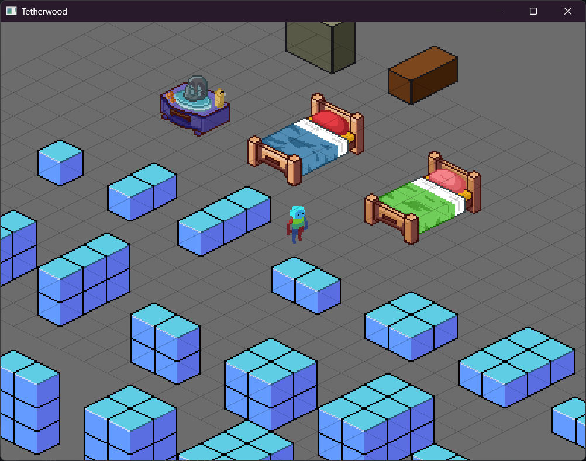
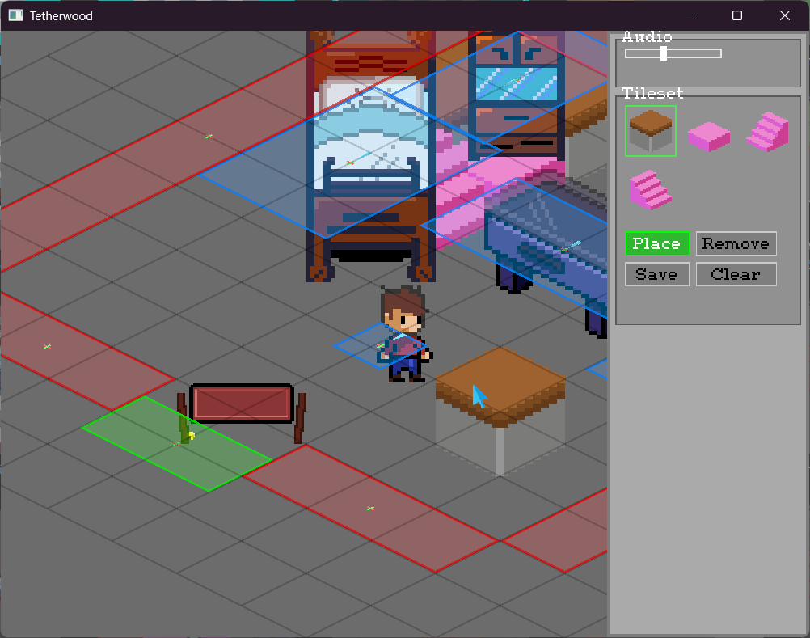

# Tetherwood


A pre-modern fantasy RPG with isometric exploration, built on a custom game engine written from scratch in **Rust**. I'm building it in public as a deep dive into systems programming, GPU rendering, and tool-building.



> **Status:** active development, Milestone 5 of the vertical slice (*"The Village"*). Not a finished game, and it's a personal learning project. The engine and tooling are the main deliverable right now.

## Why this exists

I'm a software developer with 6+ years of professional experience (TypeScript/Angular, C#/.NET, full-stack) and an M.Sc. in Informatics. Rust, engine architecture, and graphics programming were all new to me. This project is how I'm learning them properly: by building the real thing instead of following tutorials.

The governing rule is **game first, engine second**. Machinery gets extracted into reusable engine code only after the game proves it's needed, and the `src/engine/` vs `src/game/` boundary is kept structural.

## What's in it

**Rendering (wgpu)**
- Custom pipelines for sprites, tiles, solid rects, and text
- Isometric projection as a render-time transform, with an inverse for mouse picking, so collision and simulation stay in flat space
- Player-centered zoom with a smoothed camera
- Tile atlas rendering with depth sorting, plus a seam fix found by measuring pixels directly
- GPU scissor-rect clipping for scrollable UI

**Engine systems**
- Scene lifecycle with warps between scenes
- Entity and collider model with AABB collision, a spatial grid, triggers, and a dialogue system
- Isometric entity depth sorting using a per-axis-overlap AABB comparator
- A permanent `Sandbox` scene for checking entity, collider, and depth-sort edge cases

**In-engine editor tooling (built from scratch)**
- An inspector panel with sections, title bars, scrolling, and a draggable scrollbar
- Widgets: sliders, buttons, a tile palette, and a hotkey list with wrapped, multi-colour text
- Auto-layout for widgets and buttons, with TTF text layout based on measured glyph bounds
- A tile painter: place and erase, live ghost-tile preview, save and revert, multi-layer tile grid
- Tilemaps persisted with **serde + RON**

| Tile painter, ghost preview |
|---|
|  |

## Engineering process

- **Architecture Decision Records:** 100+ numbered ADRs record binding decisions. Revisiting one means writing a superseding ADR, not editing history.
- **Phase log:** every milestone is written up in [`docs/PROJECT_LOG.md`](docs/PROJECT_LOG.md), with a plan-vs-reality ledger in [`docs/DERIVATION.md`](docs/DERIVATION.md).
- **Small verified slices:** build one piece, test it, then build on top. Most bugs in the log were caught by testing a narrow slice before combining it with others.
- **Conventional commits:** `type(scope): imperative subject` with scopes `engine`, `game`, `docs`, `repo`.
- **Screenshots at each visual milestone:** committed to [`docs/screenshots/`](docs/screenshots/).

### How I use AI

I use Claude as a mentor and architecture reviewer, not as a code generator. Work is split into one milestone per session, project state lives in versioned docs, and I verify what it suggests by testing and challenging it. Several designs in the log were rejected or reversed because they broke project conventions or didn't survive testing, and those decisions are recorded with their reasoning.

## Tech stack

| Area | Crates |
|---|---|
| Language | Rust |
| Graphics | `wgpu` |
| Windowing and input | `winit` |
| Math | `glam` |
| Text | `fontdue` (TTF rasterization), hand-rolled atlas packing |
| Audio | `kira` |
| Serialization | `serde`, `ron` |
| Assets | Aseprite (`asefile`) |
| Misc | `anyhow`, `log`, `pollster` |

## Run it

```bash
git clone https://github.com/swagat-npc/tetherwood.git
cd tetherwood
cargo run
```

Requires a recent stable Rust toolchain and a GPU supported by `wgpu`. Developed and tested on Windows.

### Controls

| Key | Action |
|---|---|
| `WASD` | Move |
| `E` / `Space` | Interact / advance dialogue |
| `F1`–`F6` | Debug overlays (info, colliders, renderer, grid, neighbours, occupied cells) |
| `F8` | Toggle tile editor |
| `F10` | Toggle isometric / flat view |
| `F12` | Toggle inspector |
| Mouse wheel | Zoom (scrolls the inspector when hovering it) |
| `Ctrl+R` | Reset scene |

## Project layout

```
src/
├── engine/   # renderer, scene, entities, grid, debug + inspector tooling
├── game/     # scenes, dialogue, progression: content that uses the engine
└── main.rs
docs/
├── PROJECT_LOG.md    # ADRs and phase log
├── DERIVATION.md     # plan-vs-reality ledger
└── screenshots/
```

## Roadmap

- Finish the village scene: painted tiles, ambient NPCs, a flag-conditioned clue chain, the first guard encounter
- Entity selection and inspection in the inspector
- Confirmation guard for destructive editor actions
- Occlusion-correct isometric depth sorting
- The split-grid real-time battle system, inspired by Mega Man Battle Network

## Credits and license

- **Code** (`src/`) is released under the [MIT License](LICENSE).
- **Art, story, and game content** (everything in `assets/`, plus the game's characters, setting, and narrative) is original work by me and is **not** covered by the MIT license. All rights reserved.
- Third-party crates keep their own licenses.